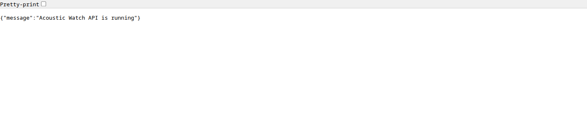
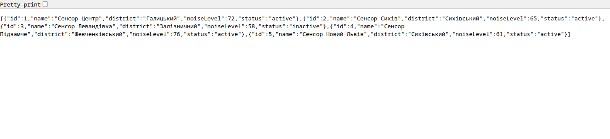
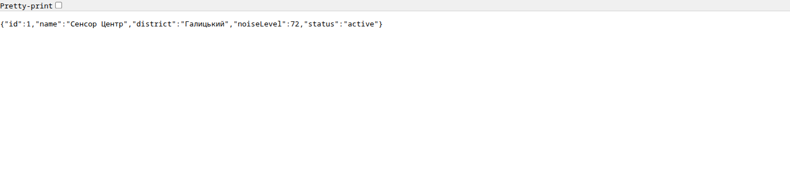
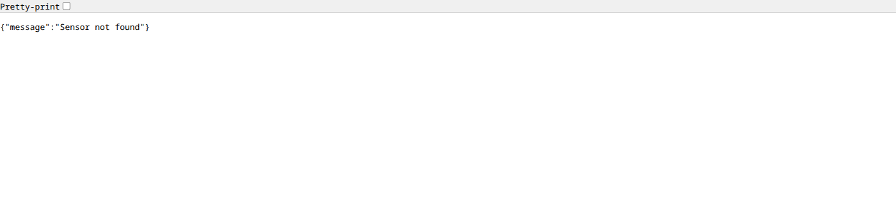

# Звіт до лабораторної роботи №10

## Тема
**Назва лабораторної роботи:** Створення серверного застосунку на Node.js.

## Мета роботи
Навчитися створювати простий серверний застосунок на Node.js та Express, запускати його локально, працювати з HTTP-маршрутами і розгортати сервер у мережі Інтернет на Render.com.

## Виконання роботи
- створено Node.js-проєкт `acoustic-watch-server` (`npm init -y`), встановлено Express (`npm install express`), додано `.gitignore` з `node_modules/` та `.env`;
- у `package.json` додано `"type": "module"` та npm-скрипти `start` (`node src/server.js`) і `dev` (`node --watch src/server.js`);
- створено файл `src/data/sensors.js` з масивом із п'яти датчиків, який тимчасово замінює базу даних;
- у `src/server.js` реалізовано Express-сервер із маршрутами `GET /`, `GET /api/sensors` та `GET /api/sensors/:id`, для неіснуючого датчика повертається код 404 з повідомленням `Sensor not found`;
- порт сервера береться з `process.env.PORT` (локально 3000), сервер слухає на `0.0.0.0`;
- проєкт завантажено у GitHub-репозиторій, на Render.com створено Web Service (Build Command `npm install`, Start Command `npm start`) і виконано deployment.

## Результат
Опублікований сервер: [Переглянути лабораторну роботу №10](https://lab-web-e8eg.onrender.com/)

Перевірка маршрутів після deployment:

`GET /` — повідомлення про роботу сервера (200):

`GET /api/sensors` — масив усіх датчиків (200):

`GET /api/sensors/1` — датчик з `id = 1` (200):

`GET /api/sensors/999` — датчик не знайдено (404):

## Висновок
Під час роботи закріплено навички створення серверного застосунку на Node.js та Express: ініціалізація проєкту, налаштування `package.json` і npm-скриптів, опис GET-маршрутів із параметром `req.params` та обробка відповіді 404. Реалізовано API датчиків, яке повертає дані у форматі JSON, і розгорнуто його на Render.com з використанням `process.env.PORT`, після чого сервер став доступним через Інтернет.
