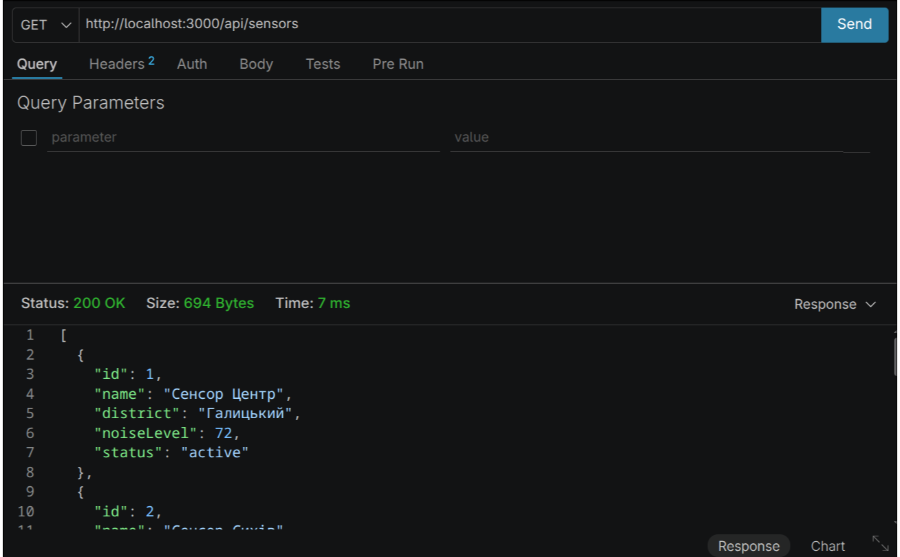
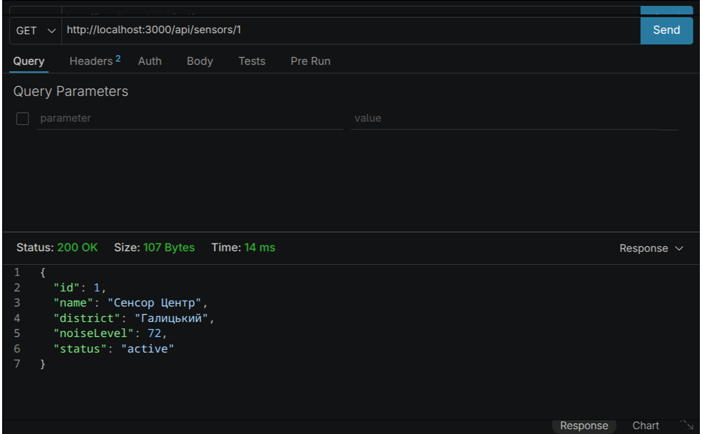
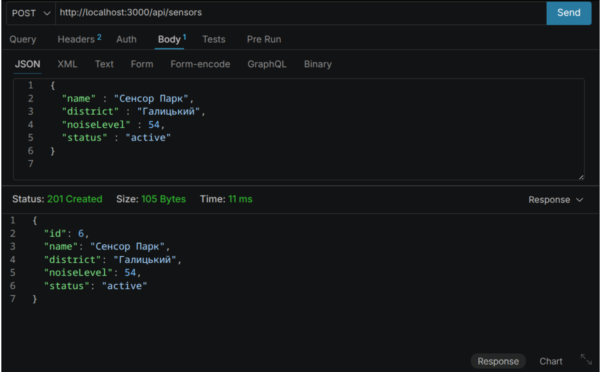
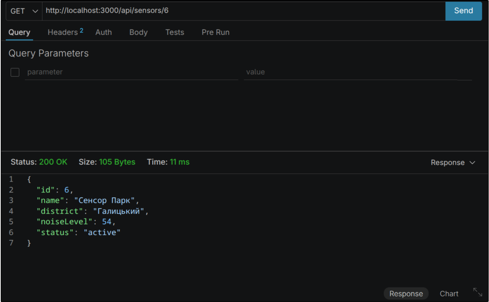
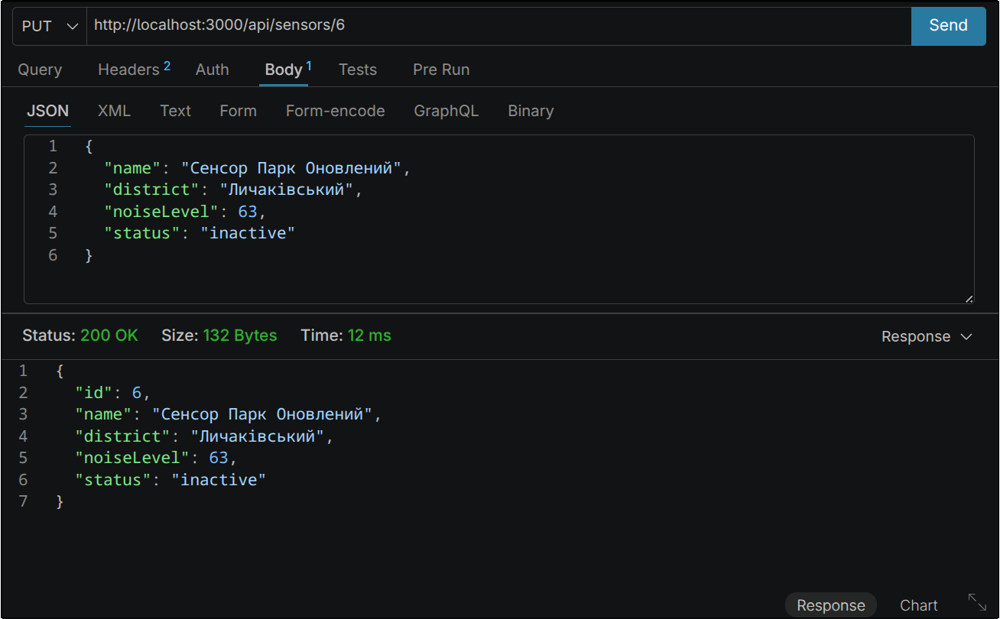
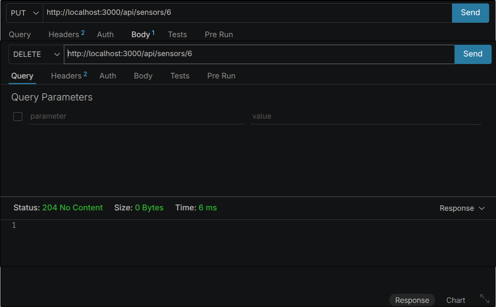

# Звіт до лабораторної роботи №11

## Тема
**Назва лабораторної роботи:** Створення REST API для бази.

## Мета роботи
Розширити наявний Express-сервер: реалізувати створення, читання, повне оновлення та видалення датчиків, перевірку вхідних даних і коректні HTTP-відповіді. Навчитися перевіряти API через Postman або Thunder Client і оновлювати застосунок на Render.

## Виконання роботи
- продовжено проєкт `acoustic-watch-server` із попередньої лабораторної: створення Express-застосунку винесено в `src/app.js`, а `src/server.js` лише запускає HTTP-сервер (порт із `process.env.PORT`, прив'язка `0.0.0.0`);
- маршрути датчиків зібрано в `src/routes/sensors.routes.js` за допомогою `express.Router()` і підключено через `app.use("/api/sensors", sensorsRouter)`;
- реалізовано CRUD: `GET /api/sensors`, `GET /api/sensors/:id`, `POST /api/sensors` (201 Created), `PUT /api/sensors/:id` (200 OK), `DELETE /api/sensors/:id` (204 No Content);
- додано валідацію `validSensor()` (непорожні `name` і `district`, `noiseLevel` — число від 0 до 120, `status` — `active` або `inactive`) і перевірку ID функцією `parseId()`, для некоректних даних повертається 400, для неіснуючого датчика — 404;
- ID нових датчиків генерує сервер за допомогою лічильника `nextId`, у `PUT` змінюються лише дозволені поля;
- додано обробку невідомих маршрутів (404 `Route not found`), некоректного JSON (400 `Invalid JSON`) та неочікуваних помилок (500);
- самостійне завдання: у `GET /api/sensors` додано фільтрацію за параметрами `status` і `district` (можна комбінувати через `req.query`) та маршрут `GET /api/sensors/stats`, який повертає кількість усіх, активних і неактивних датчиків та середній рівень шуму;
- API перевірено в Postman на локальному сервері (GET, POST, PUT, DELETE).

## Результат
Опублікований сервер: [Переглянути лабораторну роботу №11](https://lab-web-e8eg.onrender.com/api/sensors)

Перевірка API через Postman:

`GET /api/sensors` — список датчиків (200 OK):

`GET /api/sensors/1` — датчик з `id = 1` (200 OK):

`POST /api/sensors` — створення датчика (201 Created):

`GET /api/sensors/6` — перевірка, що створений датчик збережено (200 OK):

`PUT /api/sensors/6` — повне оновлення датчика (200 OK):

`DELETE /api/sensors/6` — видалення датчика (204 No Content):

## Висновок
Під час роботи закріплено навички побудови REST API на Express: поділ застосунку на `app.js`, `server.js` і роутер, реалізація операцій CRUD, використання `req.params`, `req.query` і `req.body`, валідація вхідних даних та коректні HTTP-коди (200, 201, 204, 400, 404, 500). Додатково реалізовано фільтрацію датчиків і статистику. Дані зберігаються лише в пам'яті процесу, тому після перезапуску сервера повертаються до початкового списку.
