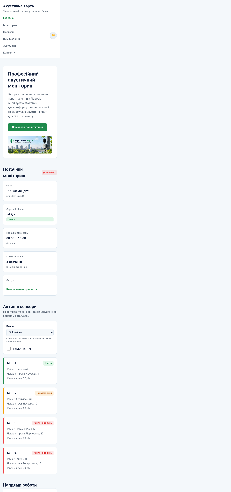

# Звіт до лабораторної роботи №6

## Тема
**Назва лабораторної роботи:** Відображення та фільтрація сенсорів у DOM.

## Мета роботи
Навчитися відображати дані сенсорів на сторінці «Акустична варта» та фільтрувати їх за районом і статусом.

## Виконання роботи
- додано секцію «Активні сенсори» з фільтром району та прапорцем «Тільки критичні»;
- використано `querySelector()` для отримання елементів керування й контейнера карток;
- реалізовано створення карток сенсорів і їх відображення в DOM;
- реалізовано комбіновану фільтрацію методом `filter()` та обробку змін через події `change`.

## Результат
Опублікована сторінка: [Переглянути лабораторну роботу №6](https://illiaderenevskyi.github.io/lab_web/lab6/index.html)

## Висновок
Під час роботи закріплено навички пошуку елементів DOM, створення карток за допомогою JavaScript і додавання їх на сторінку. Реалізовано фільтрування сенсорів за районом і критичним статусом, зокрема одночасне застосування обох умов.
