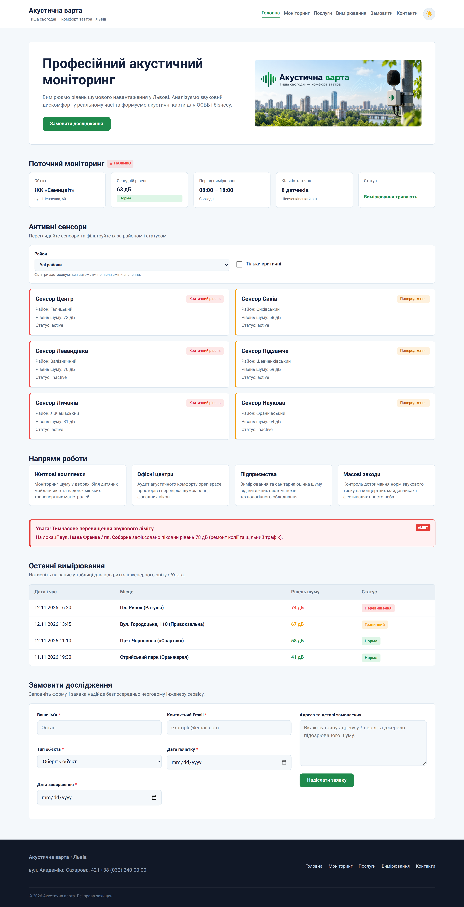

# Звіт до лабораторної роботи №7

## Тема
Завантаження даних з публічного API та відображення на сторінці.

## Мета роботи
Навчитися пояснювати, що таке API та endpoint, виконувати HTTP GET-запит за допомогою `fetch()`, перевіряти `response.ok` і `response.status`, перетворювати JSON-відповідь у масив JavaScript через `response.json()`, відображати отримані дані у вигляді карток сенсорів у DOM, перевіряти запит у DevTools → Network та обробляти просту помилку завантаження.

## Виконання роботи
- створено тестовий REST API у MockAPI (prefix `/api/v1`, ресурс `sensors`) із шістьма сенсорами;
- прибрано масив сенсорів із коду, дані завантажуються функцією `loadSensors()` через `fetch()` з перевіркою `response.ok`;
- JSON-відповідь перетворюється на масив за допомогою `response.json()` і передається у `renderSensors(sensors)`;
- картки сенсорів з назвою, районом, рівнем шуму та статусом створюються в контейнері `#sensors-list`, збережено фільтрацію за районом і критичним рівнем;
- додано обробку помилок через `try/catch` та повідомлення «Не вдалося завантажити дані.».

## Результат
Опублікована сторінка: [Переглянути лабораторну роботу №7](https://illiaderenevskyi.github.io/lab_web/lab7/index.html)

## Висновок
Під час роботи закріплено навички роботи з асинхронними запитами та `async/await`. Реалізовано отримання даних із зовнішнього REST API через `fetch()`, читання JSON та відображення даних у DOM окремою функцією, яка не залежить від джерела даних. Додано просту обробку помилок мережі та HTTP-помилок.
