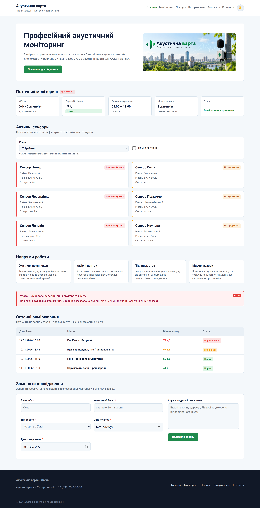

# Звіт до лабораторної роботи №8

## Тема
 Робота з даними з API на TypeScript.

## Мета роботи
Навчитися описувати структуру даних з API за допомогою `interface` у TypeScript, виконувати HTTP-запит до REST API за допомогою `fetch()`, використовувати `async/await` для асинхронного завантаження даних, передавати типізований масив `Sensor[]` між функціями та відображати отримані дані на сторінці «Акустична варта».

## Виконання роботи
- налаштовано оточення TypeScript у проєкті (`tsconfig.json`) з параметрами вихідної папки `src` та папки компіляції `dist`;
- описано структуру даних сенсора з MockAPI за допомогою `interface Sensor` у файлі `sensors.ts`;
- реалізовано асинхронну функцію `loadSensors()` із викликом `fetch()`, перевіркою `response.ok` та перетворенням відповіді на типізований масив `Sensor[]`;
- створено функцію `renderSensors()` для динамічного відображення карток сенсорів у контейнері `#sensors` із явною типізацією DOM-елементів (`HTMLDivElement`);
- скомпільовано файл `src/sensors.ts` у `dist/sensors.js` за допомогою компілятора TypeScript (`tsc`) та підключено його до `index.html`.

## Результат
Опублікована сторінка: [Переглянути лабораторну роботу №8](https://illiaderenevskyi.github.io/lab_web/lab8/index.html)

## Висновок
Під час роботи закріплено навички використання TypeScript для роботи з асинхронними даними. Реалізовано типізацію моделі сенсора через `interface`, отримання даних із зовнішнього REST API через `fetch()`, типізовану взаємодію з DOM та процес компіляції TypeScript-коду в JavaScript.
