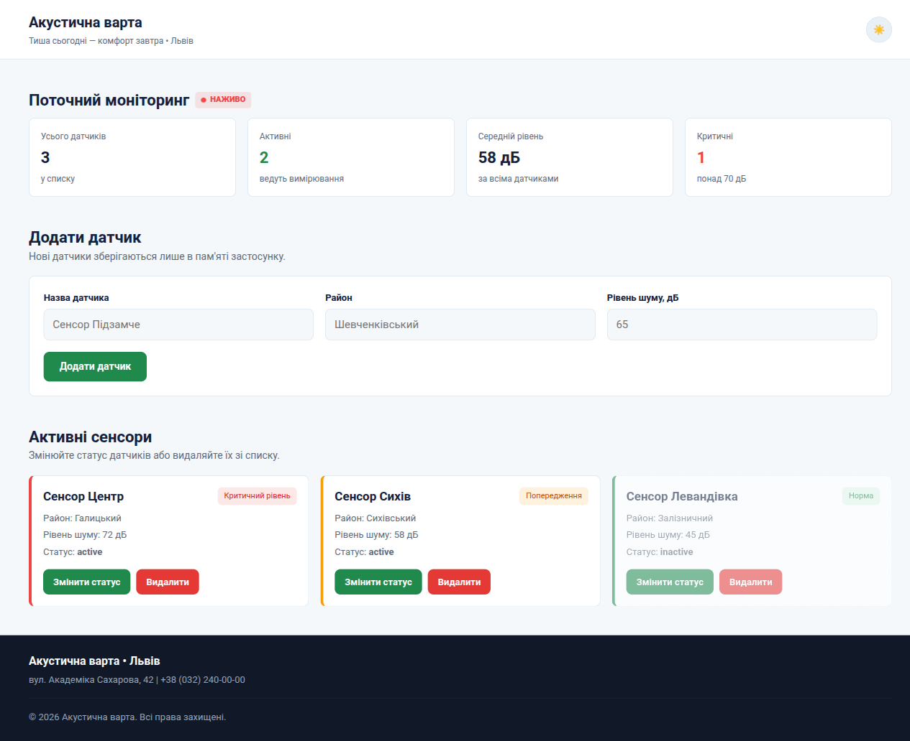

# Звіт до лабораторної роботи №9

## Тема
**Назва лабораторної роботи:** Створення простого Angular-застосунку («Todo list»).

## Мета роботи
Навчитися створювати простий Angular-застосунок, працювати з компонентом і шаблоном, відображати список даних, обробляти натискання кнопок, виконувати production build та публікувати готовий застосунок через GitHub Pages.

## Виконання роботи
- встановлено Node.js, npm та Angular CLI, версії перевірено командою `ng version`;
- створено проєкт `acoustic-watch` командою `ng new acoustic-watch --routing=false --style=css --skip-tests`;
- описано модель `Sensor` (`interface`) у файлі `sensor.ts` та початковий список датчиків у компоненті `App`;
- датчики відображено у шаблоні за допомогою `@for` з `track sensor.id` та `@empty`;
- реалізовано додавання датчика (`[(ngModel)]`, `addSensor()`), видалення (`deleteSensor()`) та перемикання статусу `active` / `inactive` (`toggleStatus()`);
- інтерфейс оформлено в стилі проєкту «Акустична варта»: шапка, перемикач теми, блок моніторингу, картки з кольором за рівнем шуму, неактивні датчики виділено візуально;
- виконано `ng build` з `--base-href`, результат розміщено у `dist/acoustic-watch/browser`.

`ng version`:

```
Angular CLI       : 22.2.5
Angular           : 22.2.4
Node.js           : 26.13.0
Package Manager   : npm 12.2.1
Operating System  : linux x64
```

Вміст `dist/acoustic-watch/browser` після `ng build`:

```
favicon.ico
index.html
main-J7GPFCYO.js
styles-4AAQQ372.css
```

## Результат
Опублікована сторінка: [Переглянути лабораторну роботу №9](https://illiaderenevskyi.github.io/lab_web/lab9/dist/acoustic-watch/browser/index.html)



## Висновок
Під час роботи закріплено навички створення Angular-застосунку: компонент, шаблон, прив'язка даних і подій, директива `@for`. Реалізовано список датчиків із додаванням, видаленням і зміною статусу без backend, зібрано production-версію командою `ng build` та підготовлено її до публікації на GitHub Pages.
